# Seoul night

A [Claude Code](https://claude.com/claude-code) mod that turns the app into a night out in Seoul: a dark neon theme, animated pixel-art backdrops, and a pixel band above the prompt that shows your usage limits as drinks.





## What it does

- **Three animated backdrops** (desktop and mobile app), switchable with `/backdrop`:
  - `han`: the Han river at night, Namsan with its tower, apartment blocks and a long bridge with moving car lights (default).
  - `cheonggye`: Cheonggyecheon stream at dusk, office towers and swinging colored lanterns.
  - `alley`: a neon alley (포차, 부동산, GS25, emart…), a pocha tent with soju and makgeolli on the tables, and small critters, one of them already a few glasses in (딸꾹).
- **A pixel band above the prompt**, drawn everywhere, including the terminal:
  - a glass of somaek for the 5-hour limit, a bottle of soju for the weekly limit, an 어묵 skewer for the conversation context;
  - a workday clock that says 칼퇴 (leave on time), 야근 (overtime) or 주말 출근 (weekend work);
  - the current git branch and the CI status of its pull request;
  - an animated critter that reacts to what Claude is doing.
- **Korean lines** while Claude works, and `한 잔 할까?` ("one drink?") under the prompt.

In the terminal the band is drawn as half-block pixel sprites with the animated critter from about 95 columns; a narrower terminal gets a single line of text. The CI status needs the GitHub CLI (`gh`) installed and logged in.

| `cheonggye` | `alley` |
|---|---|
|  |  |

After hours the band changes its tune:



## Install

In a Claude Code session in the terminal:

```
/plugin install seoul-night --marketplace p10tr13/seoul-night
```

Answer `y` when asked to add the marketplace, then pick the scope (user by default).

From the shell:

```bash
claude plugin install seoul-night --marketplace p10tr13/seoul-night
```

In the desktop app: `+` next to the prompt → Plugins → Add marketplace `p10tr13/seoul-night` → Add plugin.

## Usage

| Command | What it does |
|---|---|
| `/backdrop` | Shows the current backdrop and the ones to choose from. |
| `/backdrop <han \| cheonggye \| alley>` | Switches the backdrop. The choice is kept across sessions. |
| `/tlo` | The same in Polish. |

## Development

Instead of installing it, you can load the mod straight from a folder by listing it in `~/.claude/settings.json`:

```json
{
  "env": {
    "CLAUDE_CODE_PLUGIN_DIRS": "/path/to/seoul-night"
  }
}
```

### Layout

| Path | What it is |
|---|---|
| `hooks/register.tsx` | Entry point: theme colors, backdrops, the band, Korean lines, `/backdrop`. |
| `hooks/meter.ts` | The band's pixel art (SVG) for the desktop and mobile app. |
| `hooks/term.ts` | The band in the terminal, drawn in half blocks. |
| `hooks/critter.ts` | The critter: its states, moves and lines. |
| `hooks/scene*.ts` | Generated backdrops (SVG strings). Don't edit by hand; regenerate them. |
| `tools/gen-scene*.mjs` | Backdrop generators. |
| `tools/band-preview.mjs`, `tools/term-preview.mjs` | Previews of the band in a few situations. |
| `tests/` | Tests; run them with `claude plugin test .`. |

### Regenerating the backdrops

```bash
node tools/gen-scene.mjs hooks docs            # alley: writes hooks/scene.ts and a preview docs/alley.svg
node tools/gen-scene-han.mjs                   # han: writes scene.ts and scene.svg next to the script
node tools/gen-scene-cheonggye.mjs             # cheonggye: the same
```

Copy the `scene.ts` written by the Han and Cheonggyecheon generators to `hooks/scene-han.ts` and `hooks/scene-cheonggye.ts`.

### Previewing the band

`tools/band-preview.mjs` imports the TypeScript source, so run it with a TypeScript-aware runner such as [tsx](https://github.com/privatenumber/tsx):

```bash
npx tsx tools/band-preview.mjs hooks/meter.ts   # writes band-day.svg, band-night.svg, band-weekend.svg, band-fail.svg
```

## License

[PolyForm Strict 1.0.0](LICENSE). You're welcome to install and use the mod for personal, non-commercial purposes. You may not redistribute it, modify it, or reuse its code or artwork (the backdrops, sprites and band) in other works, and commercial use is not permitted. For anything else, get in touch.
